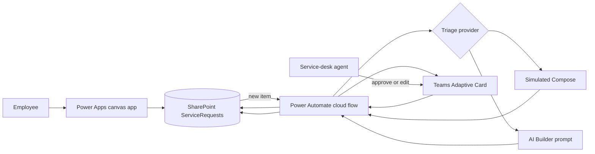

# Customer Request Triage Assistant

> A portfolio reference implementation for Microsoft 365, Power Platform, and generative AI.

> **Verification status:** The local Python/SQLite simulation has been run and tested locally. Nothing in the SharePoint, Power Apps, Power Automate, Teams, or AI Builder design has been deployed to or tested in a real Microsoft 365 tenant yet.

## Customer story

Contoso Services is a fictional mid-sized company whose internal service desk receives requests through several informal channels. Agents spend time rewriting incomplete requests, deciding where they belong, and drafting repetitive first responses. Classification is inconsistent, urgent work can be missed, and requesters do not know what happens next.

The Customer Request Triage Assistant gives employees one simple intake experience and gives service-desk agents a reviewed, AI-assisted triage queue. A Power Apps canvas app writes requests to SharePoint. Power Automate obtains a category, priority, short summary, and reply from either a license-free simulated response or an optional AI Builder prompt. A Teams Adaptive Card lets a human approve or edit those suggestions before they are treated as final.

The assistant supports a decision; it does not make an irreversible service-desk decision or send an AI-written reply directly to a requester.

## What the solution demonstrates

- A customer problem translated into an achievable Microsoft 365 architecture.
- A canvas app with clear validation, submission feedback, and delegable filtering choices.
- A cloud flow with structured AI output, defensive validation, error handling, and human review.
- Responsible-AI controls and measurable acceptance criteria.
- Honest licensing boundaries between standard Microsoft 365 connectors and paid AI capacity.

## Architecture at a glance

## Repository map

`local-sim/` is a local prototype of the workflow logic. It has been run locally, including the browser experience; it has not been connected to a Microsoft 365 tenant. The Microsoft 365 implementation artifacts are in `sharepoint/`, `powerapps/`, and `powerautomate/`, covering SharePoint, Power Apps, Power Automate, and Teams. Those artifacts are designs and build instructions only: none has currently been run or verified in a real tenant.

## Repository guide

| Path | Contents |
|---|---|
| [`docs/solution-design.md`](docs/solution-design.md) | Problem, personas, scope, architecture, and trade-offs |
| [`sharepoint/`](sharepoint/) | PnP PowerShell list provisioning and ten sample requests |
| [`powerapps/`](powerapps/) | Commented Power Fx formulas and control assumptions |
| [`powerautomate/`](powerautomate/) | Cloud-flow build guide and Adaptive Card JSON |
| [`ai/`](ai/) | Prompt, examples, JSON schema, and evaluation set |
| [`docs/responsible-ai.md`](docs/responsible-ai.md) | Risks, controls, and quality measures |
| [`docs/deployment-guide.md`](docs/deployment-guide.md) | Beginner-friendly setup and licensing caveats |
| [`docs/audit-notes.md`](docs/audit-notes.md) | Documentation-backed implementation audit and open verification items |
| [`docs/local-sim-technical-review.md`](docs/local-sim-technical-review.md) | Local application security, integrity, accessibility, test results, and remaining limits |
| [`docs/local-sim-final-qa.md`](docs/local-sim-final-qa.md) | Final local persistence, authorization, session, classifier, and development-freeze verification |
| [`docs/build-checklist.md`](docs/build-checklist.md) | Exact build order, proof checks, and outcome fields |
| [`docs/test-plan.md`](docs/test-plan.md) | Functional, failure-path, and AI-quality tests |
| [`docs/interview-prep.md`](docs/interview-prep.md) | Fifteen likely interview questions with adaptable answers |

## Suggested demo

1. Submit a realistic request in the canvas app.
2. Show the SharePoint row in `New` status.
3. Open the flow run and explain the structured AI response and allow-list validation.
4. Edit one field in the Teams card and choose **Edit and approve**.
5. Refresh the app and show the approved values.
6. Use one adversarial test from `ai/test-set.json` to explain why review is required.

## Screenshots to add

- [ ] Intake screen — `docs/images/01-intake-screen.png`
- [ ] Filtered request gallery — `docs/images/02-request-gallery.png`
- [ ] Successful flow run — `docs/images/03-flow-run.png`
- [ ] Teams review card — `docs/images/04-teams-card.png`
- [ ] Updated SharePoint item — `docs/images/05-approved-item.png`

See [`docs/images/README.md`](docs/images/README.md) for capture guidance.

## What I would do next

- Package the app and flow in a Power Platform solution and use environment variables for site, list, team, and channel identifiers.
- Add a separate audit list for reviewer identity, timestamps, original AI output, and final human values.
- Add an SLA dashboard and escalation rules based on validated business requirements.
- Run the labeled test set on every prompt revision and expand it with real, de-identified failure cases.
- Add a dead-letter path for failed AI calls and operational alerts for flow owners.
- Pilot an optional Copilot Studio intake channel only after confirming licensing, authentication, and channel requirements.

## Important licensing note

SharePoint and Microsoft Teams are standard Power Platform connectors. The simulated mode uses a built-in Compose action and needs no AI capacity. Running an AI Builder prompt consumes AI Builder or Copilot capacity; it is not guaranteed to be free in a Microsoft 365 developer tenant. Azure OpenAI is a premium connector and also incurs Azure usage charges. See the [deployment guide](docs/deployment-guide.md#licensing-and-cost-reality) before building.

## Lessons learned

Complete one copy of this template for each meaningful problem. Specific evidence is more useful in an interview than a perfect-sounding story.

### Lesson: _short title_

- **What I tried:** _What were you building or testing? What did you expect?_
- **What broke:** _What did the user see, and which action or formula failed?_
- **Evidence I collected:** _Flow run URL/date, error text, screenshot, Monitor trace, or test-case ID._
- **Root cause:** _Why did it fail? Separate the confirmed cause from assumptions._
- **How I fixed it:** _What exact change did you make, and why?_
- **How I knew it was fixed:** _Which test passed afterward?_
- **What I would do differently:** _What would prevent or detect this earlier next time?_

## Portfolio status

This repository contains source artifacts and build instructions, not exported proprietary solution packages. It is designed to be recreated safely in a development tenant and adapted to an organization's governance, data-loss-prevention, and licensing policies.
