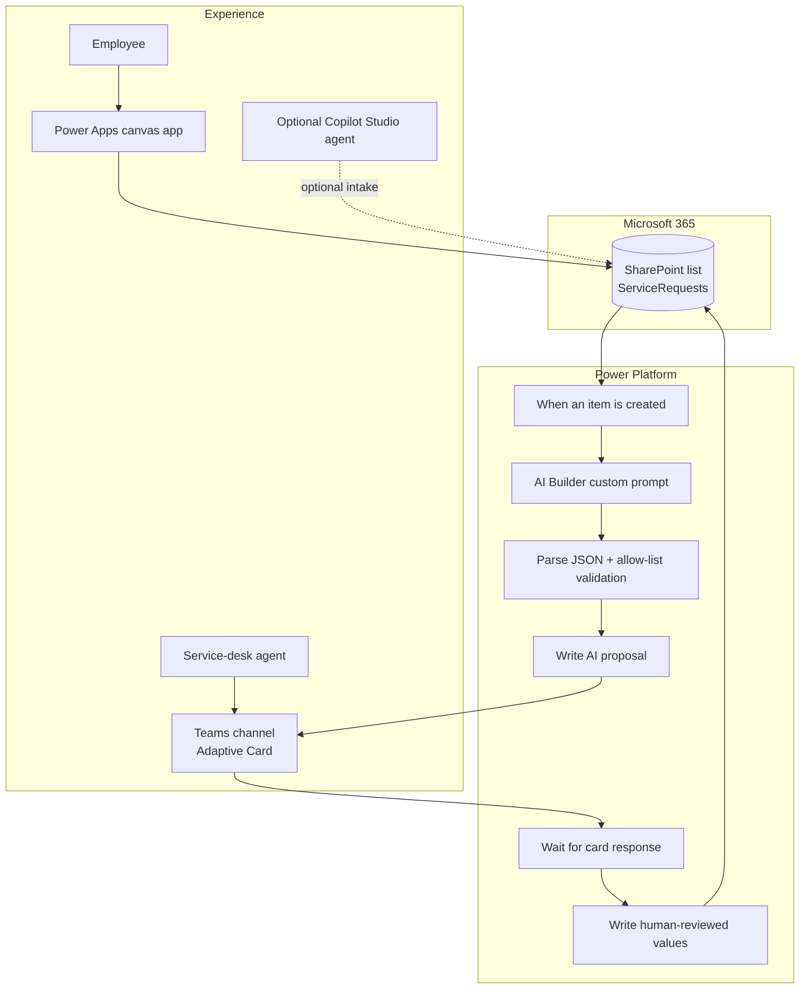

# Solution design

## Problem statement

Contoso Services' internal service desk receives requests with inconsistent detail and terminology. Agents manually interpret each request, set a category and priority, write a short summary, and draft a first response. That work is repetitive, but it also requires judgment: a request that sounds urgent might not have business-wide impact, while an understated access failure can block a new starter completely.

The proposed solution standardizes intake and uses generative AI to prepare a triage recommendation. A service-desk agent remains accountable for accepting or editing the recommendation. The goal is faster, more consistent triage without presenting model output as fact.

## Success outcomes

- Employees can submit a useful request in under two minutes.
- Agents receive a concise, consistent triage proposal in Teams.
- No suggested reply becomes approved without a human action.
- Invalid AI categories or priorities never reach the list.
- Quality can be evaluated with a labeled test set instead of anecdotal demos alone.

## Personas

### Maya — employee/requester

Maya needs help but does not know the service desk's taxonomy. She wants a short form, clear validation, and confidence that her request was recorded.

### Alex — service-desk agent

Alex reviews a busy queue. Alex needs the original request, a proposed category and priority, and an editable reply in one place. Speed matters, but so does the ability to correct the AI.

### Priya — service-desk manager

Priya owns service quality and governance. She needs consistent categories, evidence that urgent items are not being missed, and metrics that show whether the assistant helps.

### Jordan — Power Platform administrator

Jordan manages environments, connectors, permissions, data-loss-prevention policies, capacity, and solution lifecycle. Jordan needs least-privilege connections and a clear premium-license boundary.

## Scope

### In scope

- SharePoint list as the system of record for this portfolio prototype.
- Canvas app intake form and request gallery with status filtering.
- Automated flow triggered by a new list item.
- AI-generated category, priority, summary, and suggested reply in strict JSON.
- Allow-list checks before model output is written.
- Teams channel Adaptive Card with **Approve** and **Edit and approve** paths.
- Human-reviewed update of the SharePoint item.
- Prompt evaluation assets and responsible-AI documentation.

### Out of scope

- Sending the suggested reply to the requester.
- SLA enforcement, assignment, paging, or on-call escalation.
- Attachments, image analysis, multilingual translation, sentiment scoring, or knowledge-base retrieval.
- Replacing a production IT service-management platform.
- Fully autonomous approval or remediation.
- Production ALM, managed solutions, telemetry storage, and a full audit data model.

These exclusions keep the prototype credible and small enough for one maker to explain end to end.

## Architecture

### Main data path

1. Power Apps creates an item containing `Title`, `Description`, `Requester`, and the default `Status = New`.
2. The SharePoint **When an item is created** trigger starts one flow run. Later item updates do not retrigger it.
3. In simulated mode, a Compose action supplies a schema-compatible test object. In real-AI mode, AI Builder returns the same four fields. The flow parses either response and checks category and priority against fixed allow-lists.
4. The flow writes the proposal to SharePoint and sets `Status = Awaiting review`.
5. A Teams action posts an Adaptive Card to a service-desk channel and waits for one response.
6. The agent approves the proposal or edits the card fields and approves the edited values.
7. The flow writes the reviewed values and sets `Status = Approved`.

## Data model

| Display name | SharePoint type | Purpose |
|---|---|---|
| Title | Single line of text | Short requester-supplied subject |
| Description | Multiple lines, plain text | Original request; never overwritten by AI |
| Requester | Person, one value | Employee who submitted the request |
| Category | Choice | `Access`, `Hardware`, `Software`, `Microsoft 365`, `Network`, or `Other` |
| Priority | Choice | `Low`, `Medium`, `High`, or `Critical` |
| AISummary | Multiple lines, plain text | Model-generated factual summary |
| SuggestedReply | Multiple lines, plain text | Model-generated draft, subject to review |
| Status | Choice | Workflow state |
| Created | Built-in date/time | Submission timestamp managed by SharePoint |

The provisioning script uses internal name `RequestDescription` with display name `Description`. This avoids ambiguity in expressions while preserving the requested user-facing schema.

## Design decisions and trade-offs

### SharePoint list rather than Dataverse

SharePoint works with the Microsoft 365 entitlement and its connector is standard. It is familiar to reviewers and quick to provision. Dataverse would provide stronger relational modeling, auditing, security roles, and solution-aware ALM, but adds environment and licensing considerations. SharePoint is appropriate for a portfolio-scale queue, not automatically the right production choice.

### AI Builder as the primary AI path

AI Builder's **Run a prompt** action keeps the implementation inside Power Platform and is approachable for a new maker. Running prompts consumes AI Builder or Copilot capacity even though building and testing a prompt can be free. Azure OpenAI offers more model and deployment control but uses a premium connector, requires an Azure resource, and has separate consumption cost.

### Simulated AI for the first build

The flow defaults to a hardcoded Compose response with the same four-field contract. This proves the SharePoint, validation, Teams, and human-review integration without AI capacity. It does not test classification quality and must be visibly labeled as simulated. A Boolean flow variable selects the simulated or real provider path without changing downstream parsing and review steps.

### Structured output plus deterministic validation

The model is asked for a JSON object, which is easier to validate than prose. JSON syntax alone is not enough: the flow also checks category and priority against explicit values and uses safe fallbacks. This adds flow steps but prevents an unexpected model label from silently polluting reporting.

### Human approval before final status

The model prepares a recommendation, while an agent owns the decision. This adds review time and causes the flow to wait, but limits harm from incorrect priority, invented details, or inappropriate wording. For a real high-volume service desk, the review interaction and flow-run duration should be load-tested.

### Editable Adaptive Card rather than two separate systems

Agents can compare the original description and edit the proposed fields inside Teams. A card that waits for a response accepts only one successful submission; the design sets a replacement message so other agents know it was handled. Richer collaboration, parallel voting, and durable work assignment would need a different pattern.

### Trigger only on creation

Using **When an item is created** prevents the flow's own updates from causing an update loop. It also means later requester edits are not automatically reclassified. A production design could add an explicit **Re-run triage** command with authorization and audit controls.

### Plain-text fields

Descriptions and replies use plain text to reduce formatting surprises and injection surfaces in the prototype. Links can still be displayed as text. Production requirements may justify rich text with additional sanitization and rendering tests.

### Optional Copilot Studio intake

An agent could collect title and description conversationally and create the same SharePoint item. It is deliberately optional because Copilot Studio has separate licensing/capacity and channel-publishing considerations. The core solution remains complete without it.

## Security and operations assumptions

- Requesters have permission to create list items; only authorized service-desk members can review all requests and update triage fields.
- The flow uses a dedicated service account or governed connection owner, not a personal account intended to leave the organization.
- The SharePoint, Teams, and AI connectors are permitted together by the environment's data-loss-prevention policy.
- Secrets and connection references are never stored in source control.
- The Team has private membership, but **Triage Review** is a standard channel inside that Team. The Teams connector currently doesn't support posting cards to private channels.
- Flow failure notifications go to the flow owner; operational retry and dead-letter handling are listed as next steps.

## Acceptance criteria

- Empty or overly long intake fields are blocked with an actionable message.
- A valid submission creates exactly one SharePoint item.
- The flow stores only an allowed category and priority.
- A malformed or out-of-range AI response results in safe fallback values and remains reviewable.
- The Teams card shows the original request and editable proposed fields.
- Either card action records reviewed values and sets `Status` to `Approved`.
- The labeled test set and measurement plan can be run after a prompt change.
