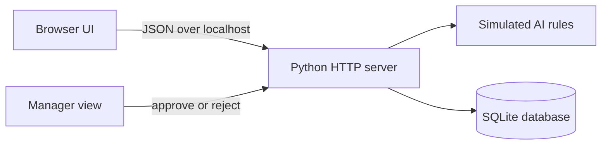

# Local service-request simulation

This is an offline companion to the Microsoft 365 project. It does not replace or modify the SharePoint, Power Apps, Power Automate, Teams, or AI Builder artifacts in the parent folders.

## What it provides

- A responsive browser intake form.
- A local SQLite database at `data/service_requests.db`.
- A deterministic keyword-based classifier using the same category/priority vocabulary as the cloud design.
- A manager queue where proposals can be edited, approved, or rejected.
- Unit and HTTP integration tests using Python's built-in `unittest`.

No Microsoft 365 account, cloud service, package manager, or third-party Python package is required. Python 3.11 or newer is recommended; this project was verified with Python 3.13.

## Run it on Windows

In the VS Code terminal:

```powershell
cd .\local-sim
.\run-local.ps1
```

If PowerShell blocks local scripts, use the equivalent direct command:

```powershell
$env:LOCAL_SIM_MANAGER_PASSCODE = "choose-a-local-passcode"
python .\app.py --host 127.0.0.1 --port 8080
```

Clear the variable after stopping the server with `Remove-Item Env:LOCAL_SIM_MANAGER_PASSCODE`.

Open <http://127.0.0.1:8080>. Use **New request** to create a record, then **Manager review** to approve or reject it. Press `Ctrl+C` in the terminal to stop the server.

The launcher prompts for a local manager passcode of at least 12 characters. The passcode is kept in the server process only. The manager signs in with that passcode and a review name; protected sessions expire when the server stops or after eight hours.

To use another port:

```powershell
.\run-local.ps1 -Port 8090
```

## Run the automated tests

Stop the development server only if you want a quieter terminal; the tests use their own temporary database and random local port.

```powershell
.\run-tests.ps1
```

Equivalent direct command:

```powershell
python -m unittest discover -s tests -v
```

The tests cover validation, classification, persistence, approval, rejection, duplicate decisions, HTTP endpoints, and static-page delivery.

## Local architecture



| File | Responsibility |
|---|---|
| `app.py` | Local web server, static-file delivery, and JSON routes |
| `service.py` | Validation and workflow rules |
| `database.py` | SQLite schema and parameterized persistence |
| `simulated_ai.py` | Deterministic category, priority, summary, and reply proposal |
| `web/` | Browser interface |
| `tests/` | Workflow and API automation |

## API summary

| Method | Route | Purpose |
|---|---|---|
| `GET` | `/api/health` | Local health check |
| `POST` | `/api/requests` | Validate, classify, and create a request |
| `POST` | `/api/manager/login` | Start a local manager session |
| `POST` | `/api/manager/logout` | End the local manager session |
| `GET` | `/api/requests?status=Awaiting%20review` | Manager-only list, optionally filtered |
| `GET` | `/api/requests/{id}` | Manager-only request details |
| `POST` | `/api/requests/{id}/decision` | Manager-only approve or reject once |

## How it maps to Microsoft 365

| Local component | Microsoft 365 counterpart |
|---|---|
| HTML intake form | Power Apps canvas form |
| SQLite table | SharePoint `ServiceRequests` list |
| Python request service | Power Automate validation and orchestration |
| Keyword classifier | Simulated Compose or optional AI Builder prompt |
| Manager review dialog | Teams Adaptive Card review |

The local `Rejected` status exists to demonstrate the requested manager decision. The original SharePoint schema is intentionally unchanged and currently uses `Needs edit` rather than `Rejected`.

## Reset local data

Stop the server and delete `data/service_requests.db`. The database and tables are recreated the next time the server or tests start. The database file is ignored by the local `.gitignore`.

## Limits

- This remains a single-machine development simulation. Its shared local passcode and self-declared manager name are not an enterprise identity system.
- Manager sessions are stored only in memory, expire after eight hours, and are lost when the server restarts. There is no password recovery, account lockout, or multi-role administration.
- Simulated AI uses transparent rules; it is not an accuracy substitute for testing a generative model.
- The local app does not execute `.powerfx`, provision SharePoint, or run a Power Automate flow.
- The server enforces loopback-only binding. It has no TLS, encrypted database, backup process, or formal security/accessibility audit, so do not store sensitive information in it.
