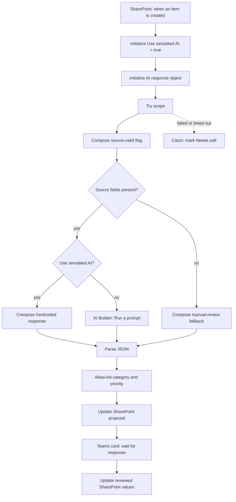

# Power Automate cloud flow build guide

## Purpose

Build an automated cloud flow named **ServiceRequests — triage and human review**. It starts once for each new SharePoint item, obtains a four-field triage proposal, validates it, writes it to the list, and waits for a service-desk agent to approve or edit it in Teams.

The flow has two provider modes with one downstream contract:

- **Simulated AI — default and license-free:** a Compose action returns a fixed JSON object. This tests the integration, not AI quality.
- **Real AI — optional:** AI Builder's **Run a prompt** action supplies the same object shape and consumes AI Builder or Copilot capacity.

Build and prove simulated mode first. Add the real branch only after the standard-connector flow works and capacity is confirmed.

## Verified connector/action names

- SharePoint trigger: **When an item is created**.
- SharePoint action: **Update item**.
- Data Operations actions: **Compose** and **Parse JSON**.
- Control actions: **Condition** and **Scope**.
- AI Builder action: **Run a prompt**; Microsoft renamed **Create text with GPT using a prompt** to this in May 2025.
- Current Teams action: **Post adaptive card and wait for a response**. Do not select the deprecated channel-specific action with the longer name.

Designer labels can vary slightly. Dynamic output shapes are generated from the selected list and card, so prefer the designer's dynamic-content tokens where this guide calls that out.

## Prerequisites

- The `ServiceRequests` list exists.
- A private-membership service-desk Team contains a **standard** channel named `Triage Review`.
- The flow connection owner is a Team member and can post in that channel.
- The Teams **Workflows** app is allowed by the tenant administrator.
- AI Builder capacity and the custom prompt are optional until real mode is enabled.

Do not use a private channel for the card. The current Teams connector documentation says posting a message or Adaptive Card to a private channel isn't supported.

## Flow outline



## Build the flow

Use the action names below exactly. Power Automate converts spaces to underscores in expressions, for example `Validated Category` becomes `outputs('Validated_Category')`.

### 1. Trigger — SharePoint: `When an item is created`

Configure the site address and the `ServiceRequests` list. Use **When an item is created**, not **created or modified**. The flow updates the same item; an update trigger would need extra conditions to prevent a loop.

Trigger concurrency is optional. If enabled for a demo, start with a modest value such as `5`; tune it only after observing tenant capacity and load.

### 2. Initialize variable — `Use simulated AI`

- **Name:** `Use simulated AI`
- **Type:** Boolean
- **Value:** `true`

This is the provider switch. Keep it `true` until the real branch is configured and licensed.

### 3. Initialize variable — `AI response`

- **Name:** `AI response`
- **Type:** Object
- **Value:** `{}`

Variables must be initialized at the top level. Branches later set this shared object, so all downstream actions are provider-independent.

### 4. Add scope — `Try - triage and review`

Place steps 5–16 inside this scope. The Catch scope later uses its result.

### 5. Compose — `Request text`

```text
concat(
  'Title: ', coalesce(triggerBody()?['Title'], ''),
  decodeUriComponent('%0A'),
  'Description: ', coalesce(triggerBody()?['RequestDescription'], '')
)
```

`RequestDescription` is the internal name created by the provisioning script. Prefer the trigger's **Description** dynamic token if the internal key differs in your run history.

### 6. Compose — `Source data valid`

```text
and(
  not(empty(trim(coalesce(triggerBody()?['Title'], '')))),
  not(empty(trim(coalesce(triggerBody()?['RequestDescription'], ''))))
)
```

The app and SharePoint schema normally prevent missing source fields. This guard covers migrated data, schema drift, and the deliberate failure test.

### 7. Condition — `Source fields present`

Set `outputs('Source_data_valid')` **is equal to** `true`.

#### If no — manual-review object

Add Compose named `Missing source response` and paste this object into **Inputs**:

```json
{
  "category": "Other",
  "priority": "Medium",
  "summary": "The source request is missing a title or description and requires manual review.",
  "suggestedReply": "Thanks for contacting the service desk. Please provide a title and a description of the issue, including who is affected and any available workaround."
}
```

Then add **Set variable** for `AI response` with the output of `Missing source response`.

#### If yes — provider switch

Add a Condition named `Choose triage provider`. Set `variables('Use simulated AI')` **is equal to** `true`.

##### If yes — simulated provider

Add Compose named `Simulated AI response` and paste this object into **Inputs**:

```json
{
  "category": "Other",
  "priority": "Medium",
  "summary": "Simulated triage response used to test the integration without AI capacity.",
  "suggestedReply": "Thanks for your request. This is a simulated draft for testing; a service-desk agent will review the original request."
}
```

Add **Set variable** for `AI response` with the output of `Simulated AI response`.

If Compose treats the pasted object as text, use this expression instead:

```text
json('{"category":"Other","priority":"Medium","summary":"Simulated triage response used to test the integration without AI capacity.","suggestedReply":"Thanks for your request. This is a simulated draft for testing; a service-desk agent will review the original request."}')
```

##### If no — real provider placeholder

For the license-free first build, add Compose named `Real AI not configured` with this object, then set `AI response` to its output:

```json
{
  "configurationError": "Set Use simulated AI to true, or configure the real AI branch."
}
```

The downstream Parse JSON action will reject this object because the four required fields are absent, causing the Try scope to fail and the Catch scope to run. Do not use a **Terminate** action here: Terminate ends the flow immediately and would bypass the later Catch scope.

### 8. Optional real-AI branch

When capacity is available, delete the placeholder Compose and its Set variable action from the **If no** branch and add these actions there.

1. Add AI Builder **Run a prompt**, select **Service Request Triage v1**, and set `RequestText` to output of `Request text`. Keep the prompt output as text containing JSON for this flow shape.
2. Add Compose `Raw AI text` and select the generated **Text** dynamic token. Do not type an undocumented response path.
3. Add Compose `Clean AI JSON` with:

```text
trim(
  replace(
    replace(outputs('Raw_AI_text'), '```json', ''),
    '```',
    ''
  )
)
```

4. Set object variable `AI response` with `json(outputs('Clean_AI_JSON'))`.
5. Save and test the branch, then change `Use simulated AI` to `false`.

If the model returns malformed JSON, `json()` fails and the Catch scope handles the run. Microsoft also offers native JSON prompt output, but it exposes a different set of designer tokens; use one output approach consistently.

### 9. Data Operations — `Parse JSON`

- **Content:** `variables('AI response')`
- **Schema:** paste `powerautomate/parse-json-schema.json`

This verifies the four required string properties. The stricter `ai/output-schema.json` remains the offline contract. Enumeration validation is explicit in the next steps.

### 10. Compose — `Validated Category`

```text
if(
  contains(
    createArray('Access','Hardware','Software','Microsoft 365','Network','Other'),
    body('Parse_JSON')?['category']
  ),
  body('Parse_JSON')?['category'],
  'Other'
)
```

### 11. Compose — `Validated Priority`

```text
if(
  contains(
    createArray('Low','Medium','High','Critical'),
    body('Parse_JSON')?['priority']
  ),
  body('Parse_JSON')?['priority'],
  'Medium'
)
```

Add Compose `Validated Summary`:

```text
if(
  empty(trim(coalesce(body('Parse_JSON')?['summary'], ''))),
  'Automated triage returned no summary; review the original request.',
  take(trim(body('Parse_JSON')?['summary']), 500)
)
```

Add Compose `Validated Reply`:

```text
if(
  empty(trim(coalesce(body('Parse_JSON')?['suggestedReply'], ''))),
  'Thanks for contacting the service desk. An agent will review your request.',
  take(trim(body('Parse_JSON')?['suggestedReply']), 1200)
)
```

These checks prevent empty provider text and limit what is placed in the card. The prompt asks for tighter 300/800-character limits; the 500/1,200 limits leave room for a reviewer's edits.

### 12. Compose — `Proposal Status`

```text
if(outputs('Source_data_valid'), 'Awaiting review', 'Needs edit')
```

### 13. SharePoint — `Update item - triage proposal`

Configure:

- **Site Address / List Name:** same as the trigger
- **Id:** trigger **ID**
- **Title / Description:** corresponding trigger values
- **Requester:** select the trigger token accepted by the designer; for many list schemas this is **Requester Claims**
- **Category / Priority:** outputs of the two validated Compose actions
- **AISummary / SuggestedReply:** outputs of `Validated Summary` and `Validated Reply`
- **Status:** output of `Proposal Status`

`Update item` has a dynamic schema. The official connector reference doesn't prescribe the exact Person-field token, so verify this field in a test run instead of copying a guessed internal path.

### 14. Condition — `Source data can be reviewed`

Set `outputs('Source_data_valid')` **is equal to** `true`.

- **If no:** add Teams **Post message in a chat or channel** to the standard review channel. Include only the request ID and state that source fields are missing. Do not post a wait card and do not set the item to Approved.
- **If yes:** place steps 14A–16 below in this branch.

This prevents a reviewer from approving a request whose required source text is missing.

### 14A. Teams — `Post adaptive card and wait for a response`

Configure:

- **Post as:** Flow bot in a commercial tenant; use an available supported poster in government tenants
- **Post in:** Channel
- **Team / Channel:** private-membership service-desk Team and its **standard** `Triage Review` channel
- **Adaptive Card:** paste `powerautomate/adaptive-card.json`
- **Update message:** `Request reviewed. Open the ServiceRequests list to see the final values.`
- **Should update card:** Yes, if shown

The card uses schema 1.4; current Teams clients support through 1.5. The wait action accepts one successful submission. The connector has an approximate 28 KB message limit; the app's 2,000-character description limit keeps this prototype below it.

The response schema is dynamic. After the first submission, inspect run history and confirm whether `action`, `category`, `priority`, `summary`, and `reply` appear under `data`. Prefer designer tokens. The expressions below are a likely observed shape, not a documented connector contract.

### 15. Compose — final reviewed values

`Final Category`:

```text
if(
  and(
    equals(body('Post_adaptive_card_and_wait_for_a_response')?['data']?['action'], 'edit'),
    contains(createArray('Access','Hardware','Software','Microsoft 365','Network','Other'), body('Post_adaptive_card_and_wait_for_a_response')?['data']?['category'])
  ),
  body('Post_adaptive_card_and_wait_for_a_response')?['data']?['category'],
  outputs('Validated_Category')
)
```

`Final Priority`:

```text
if(
  and(
    equals(body('Post_adaptive_card_and_wait_for_a_response')?['data']?['action'], 'edit'),
    contains(createArray('Low','Medium','High','Critical'), body('Post_adaptive_card_and_wait_for_a_response')?['data']?['priority'])
  ),
  body('Post_adaptive_card_and_wait_for_a_response')?['data']?['priority'],
  outputs('Validated_Priority')
)
```

`Final Summary`:

```text
if(
  and(
    equals(body('Post_adaptive_card_and_wait_for_a_response')?['data']?['action'], 'edit'),
    not(empty(trim(coalesce(body('Post_adaptive_card_and_wait_for_a_response')?['data']?['summary'], ''))))
  ),
  trim(body('Post_adaptive_card_and_wait_for_a_response')?['data']?['summary']),
  outputs('Validated_Summary')
)
```

`Final Reply`:

```text
if(
  and(
    equals(body('Post_adaptive_card_and_wait_for_a_response')?['data']?['action'], 'edit'),
    not(empty(trim(coalesce(body('Post_adaptive_card_and_wait_for_a_response')?['data']?['reply'], ''))))
  ),
  trim(body('Post_adaptive_card_and_wait_for_a_response')?['data']?['reply']),
  outputs('Validated_Reply')
)
```

Choosing **Approve** preserves the proposal. Choosing **Edit and approve** uses the edited values after validating the enumerations again.

### 16. SharePoint — `Update item - reviewed result`

Pass the same ID and required source fields as step 13. Use the four final Compose outputs and set `Status = Approved`. The prototype does not send `SuggestedReply` to the requester.

## Failure path

### 17. Add scope — `Catch - manual triage`

Place it after `Try - triage and review`. Configure **Run after** for **has failed**, **has timed out**, and **is skipped**, but not successful.

Inside it:

1. Add SharePoint **Update item** using the trigger ID and original required values.
2. Set `Category = Other`, `Priority = Medium`, `AISummary = Automated triage failed; manual review required.`, leave `SuggestedReply` blank, and set `Status = Needs edit`.
3. Add Teams **Post message in a chat or channel** to the same standard channel with the item ID and list link.
4. For production, notify a shared operations destination and minimize copied request content.

If the original failure is a required-field or Person-field mapping problem, the Catch update can fail for the same reason. Inspect the first failed action in run history.

## Test sequence

1. Keep simulated mode on; submit and approve a normal item.
2. Submit another item, edit values, and choose **Edit and approve**.
3. Put category `Facilities` in the simulated object; confirm validation changes it to `Other`.
4. Replace the simulated Compose input temporarily with invalid text; confirm Catch sets `Needs edit`. Restore valid JSON afterward.
5. Follow `docs/test-plan.md` for the missing-description guard, response shape, and regression set.
6. Configure real mode only after the simulated path passes.

## Azure OpenAI alternative — premium

Replace the real provider branch with the Azure OpenAI connector's chat-completion action, set the shared object, and keep every downstream step. The connector is Premium, requires an Azure resource/deployment, and incurs Azure usage charges. Exact model features and fields vary; validate them at build time.

## Optional Copilot Studio intake

A Copilot Studio agent can collect source fields and call a flow that creates the same list item. Keep the list as the integration boundary. Verify licensing, Copilot Credit consumption, authentication, publishing, and DLP policy before adding it.
